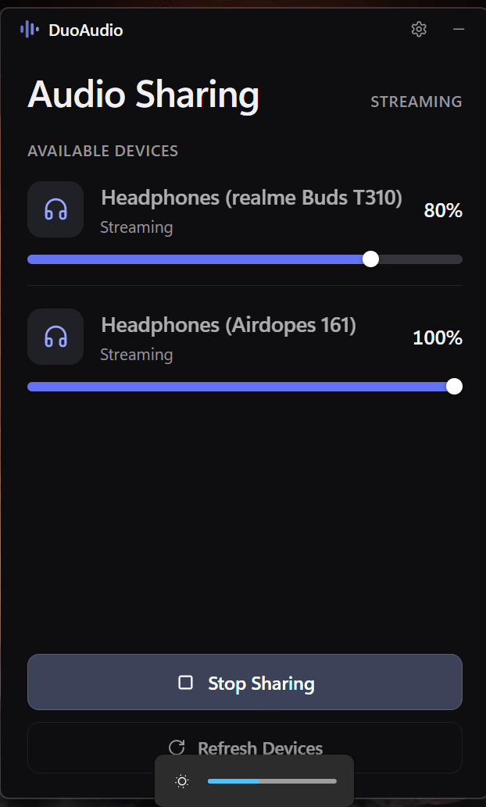

<p align="center">
  
</p>

<p align="center">
  <a href="https://github.com/Divyanshu0902/DuoAudio/releases/latest"></a>
  
  
  
  
</p>

<p align="center">
  <b>Simultaneously stream Windows 11 system audio to two pairs of Bluetooth earbuds or headphones with zero configuration.</b>
</p>

<p align="center">
  <a href="https://github.com/Divyanshu0902/DuoAudio/releases/latest"><b>Download Installer (.exe)</b></a> •
  <a href="#-key-features">Key Features</a> •
  <a href="#-architecture--tech-stack">Architecture</a> •
  <a href="#-quick-start">Quick Start</a> •
  <a href="#-building-from-source">Build from Source</a>
</p>

---

### The Problem

Windows natively supports outputting system audio to only **one** default playback device at a time. If two people want to watch a movie on a flight or listen to music together using Bluetooth earbuds, Windows forces them to share a single earbud or wrestle with complex, laggy virtual audio cables.

**DuoAudio** solves this with a lightweight, low-latency desktop utility that captures Windows system audio and duplicates it in real time to two independent output endpoints simultaneously.

---

### ✨ Key Features

- 🎧 **Simultaneous Dual Output:** Stream audio from any app (YouTube, Spotify, VLC, games, browser) to two separate Bluetooth earbuds or headphones with low latency.
- 🎯 **Zero-Configuration Routing:** No manual Windows Sound settings tinkering. DuoAudio automatically detects your devices, sets up routing in the background, and restores your default headphones when you stop.
- 🤫 **Silent Room Protection:** Automatically silences your laptop speakers during streaming so audio plays strictly inside both listeners' earbuds.
- 🎚️ **Independent Volume Control:** Adjust volume levels for each listener independently right from the app with smooth software gain.
- ⚡ **Low Latency & High Fidelity:** Direct 16-bit / 48 kHz linear PCM streaming built on Windows Core Audio (WASAPI).
- 🌙 **Minimalist Dark UI:** Compact, distraction-free interface designed to run quietly in your Windows system tray.

---

<p align="center">
  
</p>

---

### ⚙️ Architecture & Tech Stack

DuoAudio uses a decoupled, multi-process architecture to guarantee real-time audio throughput and UI responsiveness:

```
┌────────────────────────────────────────────────────────┐
│                      Windows OS                        │
│   (Media Players, Web Browsers, Games, System Sounds)   │
└──────────────────────────┬─────────────────────────────┘
                           │ WASAPI Loopback Capture
                           ▼
┌────────────────────────────────────────────────────────┐
│            DuoAudio Native Audio Engine                │
│                                                        │
│  ┌────────────────────────┐  ┌──────────────────────┐  │
│  │   Linear PCM Stream    │  │ Native C++ Helper    │  │
│  │   Ring Buffer (16/48k) │  │ (IPolicyConfig COM)  │  │
│  └───────────┬────────────┘  └──────────┬───────────┘  │
└──────────────┼──────────────────────────┼──────────────┘
               │ Independent Streams      │ Device Automation
               ▼                          ▼
    ┌──────────────────────┐   ┌──────────────────────┐
    │  Output 1 (Earbuds)  │   │  Output 2 (Earbuds)  │
    └──────────────────────┘   └──────────────────────┘
```

- **Audio Capture:** Windows Audio Session API (**WASAPI**) shared-mode loopback capture with silence suppression compensation.
- **Endpoint Automation:** Standalone native **C++ helper** (`duoaudio_endpoint.exe`) using undocumented Windows Core Audio COM interfaces (`IPolicyConfig`, `IMMDeviceEnumerator`) for rapid, silent endpoint switching and volume control without antivirus false-positives.
- **Buffer & Pacing:** Dedicated ring buffer pacing per output stream with clock-drift resilience.
- **Desktop Shell:** **Electron 33** + **React 19** + **Vite**, communicating with the audio worker via structured IPC and graceful shutdown supervisors.

---

### 🚀 Quick Start

1. **Download:** Grab the latest [`DuoAudio Setup 1.0.2.exe`](https://github.com/Divyanshu0902/DuoAudio/releases/latest).
2. **Connect Earbuds:** Pair both Bluetooth earbuds/headphones with Windows.
3. **Launch & Share:** Open DuoAudio, select your two devices in **Output 1** and **Output 2**, and click **▷ Start Sharing**.

---

### 🛠️ Building from Source

**Prerequisites:** Windows 11 (64-bit), Node.js (v22.x LTS), and MinGW GCC (`g++`).

```powershell
# 1. Clone the repository
git clone https://github.com/Divyanshu0902/DuoAudio.git
cd DuoAudio

# 2. Install dependencies
npm install

# 3. Build UI bundle & compile native helper
npm run build:ui
scripts\build-native-helper.bat

# 4. Run the desktop app
npm start
```

---

### 📄 License

This project is licensed under the **MIT License** — see the [LICENSE](LICENSE) file for details.
